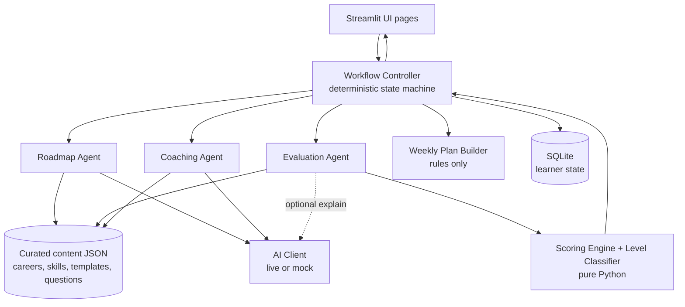
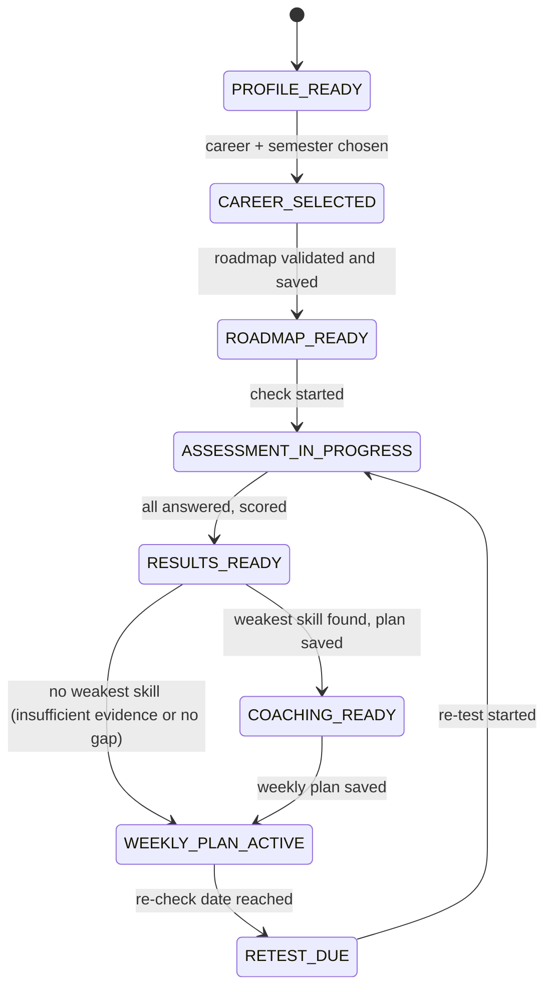
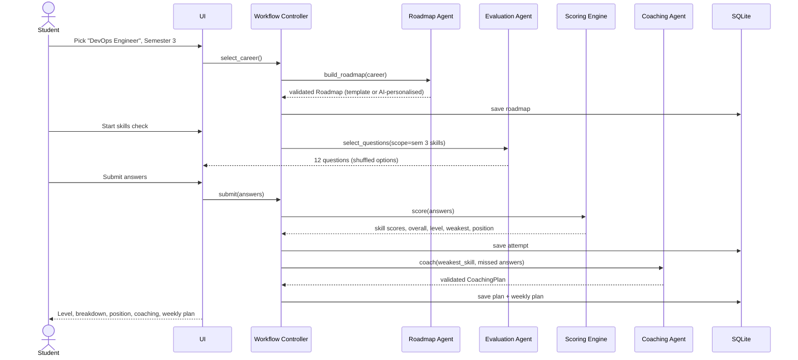

# Placement Career Coach (PCC) — Final Build Blueprint
### Focus: Computer Science students, Semesters 3–6, CS career paths

| Field | Value |
|---|---|
| Document ID | PCC-BP-002 (supersedes PCC-BP-001 and the MVP draft) |
| Version | 3.0 — merged, CS-focused, ready for build |
| Owners | Product Management, Engineering Management |
| Timebox | 3 days (Fri 09 Oct → Mon 12 Oct 2026) |
| Deliverables | (1) Product note: 3–4 pages or 6–8 slides, (2) Working prototype |
| Primary principle | Ship one complete, reliable student journey before adding anything institutional |

> **How to read this document.** Sections 1–6 define the *product*. Sections 7–16 define the *engineering*. Sections 17–24 cover *delivery*: tests, milestones, risks, traceability, the product note and the AI-assistant build contract.

---

## Table of Contents
1. [Product Definition](#1-product-definition)
2. [Career Catalog and Skill Maps](#2-career-catalog-and-skill-maps)
3. [Goals, Non-Goals and Metrics](#3-goals-non-goals-and-metrics)
4. [Student Journey and Weekly Loop](#4-student-journey-and-weekly-loop)
5. [Scope: Build First, Next, Later, Excluded](#5-scope-build-first-next-later-excluded)
6. [Functional Requirements](#6-functional-requirements)
7. [Architecture](#7-architecture)
8. [Technology Stack](#8-technology-stack)
9. [Agent and Module Specifications](#9-agent-and-module-specifications)
10. [Assessment Design and Fair Scoring](#10-assessment-design-and-fair-scoring)
11. [Content and Data Model](#11-content-and-data-model)
12. [Project Structure](#12-project-structure)
13. [Naming Conventions and Coding Standards](#13-naming-conventions-and-coding-standards)
14. [AI Guardrails and Fallbacks](#14-ai-guardrails-and-fallbacks)
15. [Security and Privacy](#15-security-and-privacy)
16. [Configuration and Environments](#16-configuration-and-environments)
17. [Testing Strategy](#17-testing-strategy)
18. [Milestones and Timeline](#18-milestones-and-timeline)
19. [Risks and Mitigations](#19-risks-and-mitigations)
20. [Demo Script](#20-demo-script)
21. [Assignment Traceability Matrix](#21-assignment-traceability-matrix)
22. [Product Note Outline](#22-product-note-outline)
23. [Post-Submission Roadmap](#23-post-submission-roadmap)
24. [AI Coding Assistant Contract](#24-ai-coding-assistant-contract)
- [Appendix A: Decision Log](#appendix-a-decision-log) · [Appendix B: Open Decisions](#appendix-b-open-decisions) · [Appendix C: Glossary](#appendix-c-glossary)

---

## 1. Product Definition

### 1.1 Problem
Computer science students in semesters 3–6 attend theory-heavy lectures but reach placement season without a clear target role, a skills plan, or honest feedback on readiness. Placement cells cannot give 1-to-1 guidance at scale.

### 1.2 Target User (deliberately narrow)
**Undergraduate Computer Science / IT students, Semesters 3–6, targeting software and IT careers.**

### 1.3 Why Computer Science Only (a product decision for the note)
| Reason | Explanation |
|---|---|
| Skills are objectively testable | Technical skills (Linux, Docker, SQL, REST) have right/wrong answers that a quiz can measure fairly. Careers like "astronaut" cannot be assessed this way. |
| Career ladders are well defined | Roles such as DevOps or Java Backend have widely agreed skill sequences, so roadmaps can be curated and verified rather than invented. |
| Placement outcomes are measurable | CS hiring tests and interviews map directly to the skills we assess. |
| Depth beats breadth in a 3-day build | Curated question banks for 4 careers beat shallow, unreliable coverage of 40. |
| Expansion is data, not code | Careers, skills, roadmaps and questions are content files. Adding ECE/VLSI or Mechanical later means adding content, not rewriting the system. |

> **Handling out-of-scope careers.** If a student enters a non-CS career, the app explains that the coach currently supports CS and IT careers, and shows the supported list. The note records this as a conscious scoping decision (see Appendix B, D1).

### 1.4 Product Promise
**Choose a CS career → get a Semester 3–6 roadmap → take a short skills check → see your level and where you stand on the roadmap → get a practice plan for your weakest skill → follow a weekly plan → re-check and see progress.**

### 1.5 Product Principles
1. **Deterministic decisions, AI-assisted content.** Code computes scores, levels, weakest skill and next step. AI may draft roadmap detail and coaching text. It never grades and never routes the workflow.
2. **Evidence-linked coaching.** Every practice task links to a missed question or a specific concept.
3. **Transparent results.** Show overall score, per-skill scores with sample counts, the level rules, and any insufficient-evidence warning.
4. **Graceful failure.** No API key, a timeout, or invalid AI output must not break the core demo.
5. **Honest labelling.** The result is a *baseline knowledge check*, not proof of job readiness.
6. **MVP first.** No login, roles or admin console in the submission window.

---

## 2. Career Catalog and Skill Maps

### 2.1 Launch Catalog (4 careers, tiered by build depth)

| Tier | Career ID | Career Name | What is built |
|---|---|---|---|
| **A** | `devops_engineer` | DevOps Engineer | Roadmap, full question bank (all semesters), all features. The polished demo path |
| **B** | `mean_stack_developer` | MEAN Stack Developer | Roadmap + Semester 3 question bank at minimum; extend if time allows |
| **B** | `java_backend_developer` | Java Backend Developer | Roadmap + Semester 3 question bank at minimum |
| **B** | `ai_developer` | AI Developer (ML and GenAI) | Roadmap + Semester 3 question bank at minimum |
| C (later) | `cloud_engineer`, `cybersecurity_analyst`, `data_engineer`, `qa_automation_engineer`, `android_developer` | — | Roadmap-first additions after submission |

**Assessment availability is derived, not hard-coded.** A skill is assessable only if the question bank has at least the required number of approved questions (Section 10.2). The app shows "Assessment for this semester is coming soon" instead of failing when a bank is thin.

### 2.2 Roadmap Shape (identical for every career)
- Semesters **3, 4, 5, 6**.
- **4 learning months per semester** (exam and break months excluded), so **16 month entries** per roadmap.
- **One primary skill per month**, so each semester has exactly 4 skills and each roadmap has 16 skills.
- Each month: focus, 2 or more topics, one deliverable.
- Skills carry a `skill_type`; only `conceptual` and `reasoning`-light skills are quiz-assessable in the MVP. Capstone and interview skills are **non-assessable by MCQ** and excluded from scoring and coverage.

### 2.3 Skill Maps

Legend: **Q** = quiz-assessable core skill, **B** = build skill (assignment, later), **C** = communication (interview, later). Months 1–4 run in the order listed.

#### DevOps Engineer (`devops_engineer`)
| Sem | Theme | Month 1 | Month 2 | Month 3 | Month 4 |
|---|---|---|---|---|---|
| 3 | Foundations | `linux_fundamentals` Q | `shell_scripting` Q | `python_for_automation` Q | `git_version_control` Q |
| 4 | Build and ship | `networking_fundamentals` Q | `ci_cd_pipelines` Q | `docker_containers` Q | `cloud_fundamentals` Q |
| 5 | Orchestrate and automate | `kubernetes_orchestration` Q | `terraform_iac` Q | `configuration_management` Q | `gitops_and_deployment_strategies` Q |
| 6 | Operate and get hired | `monitoring_observability` Q | `devsecops_basics` Q | `capstone_devops` B | `interview_preparation` C |

#### MEAN Stack Developer (`mean_stack_developer`)
| Sem | Theme | Month 1 | Month 2 | Month 3 | Month 4 |
|---|---|---|---|---|---|
| 3 | Web foundations | `javascript_fundamentals` Q | `html_css_fundamentals` Q | `git_version_control` Q | `nodejs_fundamentals` Q |
| 4 | Back end and data | `typescript_essentials` Q | `express_rest_apis` Q | `mongodb_data_modeling` Q | `authentication_authorization` Q |
| 5 | Front end and quality | `angular_core_concepts` Q | `rxjs_and_state_management` Q | `testing_web_applications` Q | `ci_cd_and_deployment` Q |
| 6 | Production and hiring | `web_security_and_performance` Q | `system_design_basics` Q | `capstone_mean` B | `interview_preparation` C |

#### Java Backend Developer (`java_backend_developer`)
| Sem | Theme | Month 1 | Month 2 | Month 3 | Month 4 |
|---|---|---|---|---|---|
| 3 | Core Java and data | `java_core_oop` Q | `collections_and_generics` Q | `dsa_problem_solving` Q | `sql_and_relational_databases` Q |
| 4 | Spring foundations | `spring_boot_fundamentals` Q | `rest_api_design` Q | `jpa_hibernate` Q | `multithreading_and_concurrency` Q |
| 5 | Secure, distributed services | `spring_security` Q | `microservices_architecture` Q | `messaging_and_events` Q | `testing_junit_mockito` Q |
| 6 | Production and hiring | `docker_and_deployment` Q | `system_design_basics` Q | `capstone_java` B | `interview_preparation` C |

#### AI Developer (`ai_developer`)
| Sem | Theme | Month 1 | Month 2 | Month 3 | Month 4 |
|---|---|---|---|---|---|
| 3 | Data and math foundations | `python_for_data_science` Q | `math_for_ml` Q | `data_analysis_with_pandas` Q | `git_version_control` Q |
| 4 | Machine learning | `machine_learning_fundamentals` Q | `feature_engineering_and_evaluation` Q | `deep_learning_fundamentals` Q | `nlp_fundamentals` Q |
| 5 | Build AI applications | `llm_and_prompt_engineering` Q | `rag_and_vector_databases` Q | `ai_apis_and_agents` Q | `mlops_basics` Q |
| 6 | Ship and get hired | `model_deployment_and_serving` Q | `responsible_ai_and_evaluation` Q | `capstone_ai` B | `interview_preparation` C |

> **Content ownership.** Skill lists above are the *reference design*. Final skill names, prerequisites and topics are authored in `data/content/` and reviewed by the PM before the build freezes (Milestone M1). Prerequisites default to "earlier month in the same roadmap" unless declared otherwise.

---

## 3. Goals, Non-Goals and Metrics

### 3.1 Goals
| ID | Goal |
|---|---|
| G1 | Student receives a Sem 3–6 roadmap in under 30 seconds of choosing a career (instant when from template) |
| G2 | Student completes a 12-question skills check in about 15 minutes |
| G3 | Student sees level, per-skill scores with sample counts, and roadmap position |
| G4 | Coaching targets the weakest evidenced skill and cites the student's mistakes |
| G5 | Same answers always produce the same score and level |
| G6 | The full flow works with no AI key (mock/template mode) |
| G7 | Student can come back, re-test and see what improved |

### 3.2 Non-Goals (this submission)
Authentication or roles, teacher/admin screens, cloud deployment, voice interviews, written/practical grading, proctoring, recruiter marketplace, resume builder, non-CS careers.

### 3.3 Product Success Metrics (for the note)
| Metric | Definition |
|---|---|
| Weekly Active Learners | Students who complete at least one weekly task or check |
| Weekly Plan Completion | Tasks completed ÷ tasks assigned |
| Re-test Rate | Students who re-test within 10 days of a coaching plan |
| Skill Gap Closure | Weakest-skill score change between consecutive attempts |
| Level Progression | Students moving up one or more levels per semester |
| Placement Readiness Share | Cohort share at Advanced or above by Semester 6 (future, institutional) |

### 3.4 Prototype Acceptance Checklist
- [ ] DevOps Engineer works end to end **without** an AI key
- [ ] Roadmap has exactly semesters 3–6 and 16 month entries, all skill IDs valid
- [ ] Assessment questions map only to roadmap skill IDs
- [ ] Same answers → same score and level (test proves it)
- [ ] Level boundary tests pass (Section 17)
- [ ] Weakest-skill logic excludes skills with fewer than 2 answered questions
- [ ] Industry-ready gate and coverage rule tested
- [ ] Every coaching task links to a missed question ID or concept tag
- [ ] Invalid AI output falls back or shows a clear, recoverable message
- [ ] Progress persists after closing and reopening the app
- [ ] Re-test uses unseen questions first
- [ ] Demo runs from a fresh launch with no manual data edits
- [ ] Product note answers every assignment question and matches the app

---

## 4. Student Journey and Weekly Loop

### 4.1 From "I don't know" to Job-Ready

| Stage | Student state | System action | Output |
|---|---|---|---|
| 1. Discover | Unsure which CS role fits | **Career Finder** (5-question rule-based quiz, P1) or browse the 4 careers | Chosen career |
| 2. Plan | "What do I learn, when?" | Roadmap module builds Sem 3–6, month-wise | Roadmap |
| 3. Baseline | "Where do I stand?" | Skills check on the student's current-semester skills | Level, skill scores, roadmap position |
| 4. Improve | "What do I fix first?" | Coaching module on weakest evidenced skill | Practice plan tied to mistakes |
| 5. Weekly | "What do I do this week?" | Rule-based weekly plan, 3–5 tasks | Weekly plan with re-check date |
| 6. Re-check | "Did it work?" | Re-test with unseen questions, compare with last attempt | Progress delta |
| 7. Advance | "What's next?" | If skill ≥ mastery, move position forward | Updated roadmap marker |
| 8. Ready | "Am I placement-ready?" | **Full-path check** across all core skills (P1) | Industry-ready or the exact remaining gaps |

### 4.2 Weekly Loop
```
Day 0:  Baseline → results → coaching plan → weekly plan generated
Day 1–6: Student works through 3–5 tasks (2–4 hours total)
Day 7:  Re-check prompt (unseen questions, same skills) → new scores
Day 7+: Compare with previous attempt → new weekly plan
```

### 4.3 Why They Come Back (return hooks)
1. **"You are here" marker** on the roadmap that moves as skills are mastered.
2. **A concrete weekly plan**, not a generic reading list.
3. **One clear weakest skill** to fix, with a short plan.
4. **Visible improvement** after a re-test ("Linux 33% → 67%").
5. **A close target:** "1 more skill above 60 to reach the next level."
6. *(Later)* private streaks, reminders, teacher remarks.

### 4.4 Who Decides What Happens After a Check (deterministic rules)

| Skill score on re-check | Next action | Decided by |
|---|---|---|
| ≥ 80 | Mark mastered; advance to next roadmap skill | Workflow controller |
| 60–79 | Mastered; add one light revision task | Workflow controller |
| 40–59 | Keep skill active; new coaching plan from new mistakes | Workflow controller → Coaching module |
| < 40 | Keep skill active; coaching plan; show "consider asking your mentor" prompt | Workflow controller |
| Two consecutive drops | Same as above; flagged in progress view (teacher alert is Later) | Workflow controller |

### 4.5 Weekly Plan Rules (plain Python, no Planner Agent)
- 3–5 tasks, about 2–4 hours total (configurable).
- Up to 2 tasks from the coaching plan for the weakest skill.
- 1 task from the next roadmap topic (if no major gap).
- 1 revision task for a skill scored 60–79, if any.
- 1 closing task: "Re-check on <date>".
- Each task has an observable completion check.

---

## 5. Scope: Build First, Next, Later, Excluded

**Ordering logic:** (1) required by the assignment, (2) unlocks other work, (3) demonstrates product thinking, (4) lowest risk first.

### 5.1 Build First (P0, must ship)
| ID | Feature | Why first |
|---|---|---|
| P0-1 | Career picker (4 CS careers) | Entry point |
| P0-2 | Sem 3–6 roadmap, month-wise, validated, with template fallback | Assignment requirement |
| P0-3 | Semester skills check (12 questions) from a curated bank | Assignment requirement |
| P0-4 | Deterministic scoring, 4-level classification, skill gate | Fairness |
| P0-5 | Per-skill breakdown with sample counts and roadmap position | "Where do I stand" |
| P0-6 | Coaching plan for weakest evidenced skill, linked to mistakes | Assignment requirement |
| P0-7 | Weekly plan (rules) + re-check prompt | Retention |
| P0-8 | SQLite persistence (profiles, attempts, plans) | Makes weekly loop real |
| P0-9 | Content validation, fallbacks, tests, README | Reliability |

### 5.2 Build Next (P1, only after P0 is complete and tested)
- Re-test with unseen-first selection and progress comparison view
- Career Finder (rule-based, 5 questions)
- Full-path readiness check (needs deeper question banks)
- Custom CS career (AI-drafted roadmap, flagged unverified, no assessment)
- "Explain my mistakes" AI feature on the results page
- Demo answer simulator (demo mode only) to show all four levels deterministically
- Tier B careers extended to Semesters 4–6 question banks

### 5.3 Build Later (P2 / post-submission)
- Written-test and assignment assessments with rubrics; voice interview
- Teacher view (read-only cohort dashboard, remarks), admin console (catalog, thresholds, question approval)
- Login and roles, cohorts
- Adaptive testing, reminders, streaks, charts, PDF readiness report
- Learning-resource recommender with vetted links
- More CS careers (Tier C) and later non-CS domains

### 5.4 Deliberately Excluded (and why)
| Item | Reason |
|---|---|
| Login, roles, permissions | Brief says not required; adds risk without proving the core idea |
| Separate agent services, queues, workers, agent frameworks | Over-engineering for a prototype; agents are modules |
| Proctoring | High cost, privacy risk; low-stakes weekly checks instead |
| Job marketplace, resume builder | Different products; dilute focus |
| Public leaderboards | Can demotivate weaker students |
| Live LLM-generated answer keys | Unreliable; fairness risk |
| Non-CS careers | See Section 1.3 |

**Scope rule:** do not start any P1 item until the P0 flow runs end to end with tests green.

---

## 6. Functional Requirements

| ID | Requirement | Pri |
|---|---|---|
| FR-01 | Student picks or creates a profile by display name (no password) | P0 |
| FR-02 | Student selects a career and current semester (3–6) | P0 |
| FR-03 | System shows a validated Sem 3–6 roadmap with month-wise topics and deliverables | P0 |
| FR-04 | Student starts a skills check for current-semester skills (3 questions per skill) | P0 |
| FR-05 | All questions must be answered before submitting | P0 |
| FR-06 | Results show overall score, level, per-skill score with `correct/answered`, and level rules | P0 |
| FR-07 | Results show roadmap position ("you are here") | P0 |
| FR-08 | Results show weakest skill, or "not enough evidence yet" | P0 |
| FR-09 | Coaching plan: 3–5 tasks for the weakest skill, each linked to a missed question or concept | P0 |
| FR-10 | Weekly plan: 3–5 tasks with a re-check date | P0 |
| FR-11 | Progress persists across sessions in SQLite | P0 |
| FR-12 | Missing or invalid AI output triggers fallback; user sees a clear message if no fallback exists | P0 |
| FR-13 | Re-test prefers unseen questions; shows deltas vs previous attempt | P1 |
| FR-14 | Career Finder suggests careers from 5 questions | P1 |
| FR-15 | Full-path check across all core skills; Industry-ready possible only here | P1 |
| FR-16 | Custom CS career produces an AI-drafted, clearly flagged roadmap | P1 |
| FR-17 | Non-CS career input returns a clear "not supported yet" message with the supported list | P0 |

**Non-functional:** roadmap from template ≤ 1 s; AI roadmap ≤ 30 s with a progress indicator; scoring is pure and offline; `make setup && make run` starts the app; ≥ 90% test coverage on `domain/scoring`.

---

## 7. Architecture

### 7.1 Principles
1. Layered, one-way dependencies: `ui → workflow → agents / domain / persistence → ai / content`.
2. The LLM drafts content; **code decides** scores, levels, weakest skill and workflow state.
3. Contracts first: every module input and output is a typed Pydantic model.
4. Fail soft: template or clear message, never invented results.
5. Content is data: careers, skills, roadmaps and questions are versioned JSON.
6. Keep it small: no interfaces or frameworks without a concrete need.

### 7.2 Logical Architecture


### 7.3 Component Responsibilities
| Component | Does | Must not |
|---|---|---|
| UI pages | Collect input, render results | Hold scoring rules, SQL or prompts |
| Workflow controller | Validate prerequisites, run steps in order, persist state, pass context | Ask an LLM what happens next |
| Roadmap Agent | Load template, optionally personalise month detail via AI, validate, fallback | Add, remove or reorder skills |
| Evaluation Agent | Select questions, collect answers, call scoring, build result object | Let AI grade or set levels |
| Scoring Engine / Level Classifier | Compute skill/overall scores, level, gates, weakest skill, position | Use network or AI |
| Coaching Agent | Plan for the given weakest skill using missed answers; validate; fallback | Pick a different skill than scoring chose |
| Weekly Plan Builder | Assemble 3–5 tasks by rules | Call AI |
| AI Client | One adapter: timeouts, structured output, mock mode | Be called from UI code |
| Persistence | Save and load learner state | Store content or secrets |

### 7.4 Workflow State Machine

Rules: roadmap must validate before an assessment; questions must reference roadmap skills; scoring is authoritative; coaching receives the computed weakest skill; if data is missing, show a clear error with retry and never invent results.

### 7.5 Shared Context (passed between modules)
```python
class StudentContext(BaseModel):
    profile_id: int
    career_id: str
    current_semester: int                  # 3..6
    roadmap: Roadmap | None
    attempt_id: int | None
    answers: list[Answer]
    skill_scores: dict[str, SkillScore]    # skill_id -> score object
    overall_score: float | None
    level: Level | None
    level_notes: list[str]                 # gate / coverage explanations
    weakest_skill_id: str | None
    missed_question_ids: list[str]
    roadmap_position: RoadmapPosition | None
```
Each module receives only the fields it needs. **No names or personal data go to the AI provider.**

### 7.6 End-to-End Sequence


---

## 8. Technology Stack

| Area | Choice | Reason |
|---|---|---|
| Language | Python 3.11 | Simple, testable |
| UI | Streamlit (`st.navigation` multipage) | Fastest path to a clear demo |
| Contracts | Pydantic v2 | Validates content and AI output |
| Learner state | SQLite via stdlib `sqlite3` (WAL, foreign keys ON) | Zero setup; supports the weekly loop |
| Curated content | JSON files in `data/content/` | Version-controlled, reviewable, diff-able |
| AI | One adapter; live provider (default Anthropic API) or mock | Isolated and swappable |
| Config | `pydantic-settings` + `.env` | 12-factor style |
| Logging | Python `logging`, JSON lines | Simple and parseable |
| Tests | pytest, pytest-cov, Streamlit `AppTest` | Protect scoring and flow |
| Quality | ruff (lint + format), mypy on `domain/` and `workflow/` | Enterprise hygiene without heavy tooling |
| Packaging | `requirements.txt`, `pyproject.toml` (tool config), `Makefile` | One-command workflows |

Optional if time remains: Docker, GitHub Actions (lint + test), pre-commit.

---

## 9. Agent and Module Specifications

### 9.1 Catalogue
| Module | Type | AI used? | Status |
|---|---|---|---|
| Workflow Controller | Deterministic orchestrator | No | P0 |
| **Roadmap Agent** | Agent | Optional: personalises month detail only | P0 |
| **Evaluation Agent** | Agent | No for scoring; optional "explain my mistakes" | P0 (explain = P1) |
| **Coaching Agent** | Agent | Yes for task wording; template fallback | P0 |
| Weekly Plan Builder | Rules | No | P0 |
| Career Finder | Rules | No | P1 |
| Planner Agent, Interview Agent, Progress Tracker, Discovery Agent | Future agents | Yes/No | Later |

### 9.2 Roadmap Agent
**Input:** `career_id`, curated skill list with prerequisites, semesters 3–6.
**Output:** `Roadmap` (16 month entries).

**Flow**
1. Load the curated roadmap template (always available for the 4 launch careers).
2. If AI is live, ask it to enrich each month's `topics` and `deliverable` for CS students. **The skill sequence is fixed and cannot be changed by AI.**
3. Validate. If invalid, one repair attempt, then use the template.
4. Save with `generation_source = ai_personalised | template`.

**Validation rules**
| ID | Rule |
|---|---|
| V-RM-01 | Semesters are exactly 3, 4, 5, 6 |
| V-RM-02 | Exactly 4 months per semester (16 total) |
| V-RM-03 | Every month's `skill_id` exists in the catalog |
| V-RM-04 | Month-to-skill sequence equals the template's sequence |
| V-RM-05 | Every catalog skill for the career appears exactly once |
| V-RM-06 | Prerequisites appear before dependants |
| V-RM-07 | Each month has a focus, at least 2 topics, and a deliverable |
| V-RM-08 | No URLs in AI-written fields |

**Custom CS career (P1):** if text maps to no catalog career, classify it (alias match first, then AI yes/no "is this a software/IT career"). If yes, AI drafts 16 skills in order; save with `source = ai_drafted_unverified`, show a banner, and state that assessment is not available. If AI is down or the career is non-CS, show the limitation and the supported list. Never present a made-up roadmap as verified.

### 9.3 Evaluation Agent
**Responsibilities:** select questions, present them with shuffled options, collect answers, call the Scoring Engine, return `EvaluationResult`. **Grading is done by code comparing option IDs.**

**Question selection**
1. **Scope:** current-semester skills that are quiz-assessable and have enough approved questions.
2. **Per skill:** 3 questions, fixed difficulty mix **1 easy, 1 medium, 1 hard**.
3. **Unseen-first:** exclude questions the student has already seen; if the pool runs out, reuse the least recently seen.
4. **Shuffle:** option display order shuffled using a stored `shuffle_seed` so a review screen can reproduce it.
5. All questions must be answered to submit.

**Optional AI role (P1):** after scoring, generate a short plain-language explanation of each missed concept. Output is advisory text only and cannot change any score.

### 9.4 Coaching Agent
**Trigger:** after scoring, when a weakest evidenced skill exists.
**Input:** weakest skill, missed question stems with the student's chosen vs correct answer, concept tags, level, career.
**Output:** `CoachingPlan` with 3–5 tasks.

```json
{
  "skill_id": "linux_fundamentals",
  "diagnosis": "Mixes up permission digits and process states.",
  "tasks": [
    {
      "order": 1,
      "title": "Permission digits drill",
      "linked_question_id": "q_linux_fundamentals_004",
      "concept_tag": "file_permissions",
      "misconception": "Thinks chmod 755 gives everyone write access",
      "action": "Create 5 files, set modes from a given table, verify with ls -l",
      "resource_hint": "man chmod; search: linux file permissions octal",
      "estimated_minutes": 30,
      "success_check": "Explain each digit of 755 without notes"
    }
  ],
  "retest_after_days": 7
}
```

**Validation rules**
| ID | Rule |
|---|---|
| V-CO-01 | 3–5 tasks |
| V-CO-02 | Every task has `linked_question_id` (a missed question) or a `concept_tag` from the missed set |
| V-CO-03 | `skill_id` equals the scoring engine's weakest skill |
| V-CO-04 | Total time ≤ configured limit (default 240 minutes) |
| V-CO-05 | Every task has an observable `success_check` |
| V-CO-06 | No URLs; `resource_hint` is a topic or search phrase. Vetted links come only from seeded content |

**Fallback:** a template plan built from the missed concepts' curated `practice_templates` in `skills.json`.

### 9.5 Weekly Plan Builder (rules only)
Implements Section 4.5. Pure function: `build_weekly_plan(context, config) -> WeeklyPlan`. Fully unit-tested.

### 9.6 Career Finder (P1, rules only)
Five multiple-choice questions (e.g., "I enjoy: A) automating and fixing systems, B) building UIs, C) designing APIs and data models, D) working with data and models"). Each option adds weights to careers; top 2 are shown with a one-line reason. Deterministic and explainable.

### 9.7 Failure Handling
| Failure | Behaviour |
|---|---|
| No AI key | Mock mode: templates for roadmap and coaching; banner "running in offline mode" |
| Timeout or API error | One retry, then fallback |
| Invalid JSON or schema mismatch | One repair attempt, then fallback |
| Output breaks a validation rule | Reject, log, fallback |
| Thin question bank | Show "assessment coming soon" for that scope |
| No skill with enough evidence | Show "not enough evidence yet"; no weakest skill invented |

---

## 10. Assessment Design and Fair Scoring

### 10.1 Method Selection
| Skill type | Best method | Why | Status |
|---|---|---|---|
| Conceptual knowledge (Linux commands, SQL, HTTP, JS semantics) | **Multiple-choice quiz** | Objective, fast, scalable | **Build now** |
| Reasoning and design (system design, security analysis) | Written response with rubric | Shows thinking | Later |
| Applied build skills (Docker, Terraform, CI/CD, REST APIs) | **Hands-on assignment** with checklist | Proves ability to do | Later |
| Communication and interview readiness | **Voice interview** with common rubric | Tests articulation | Later |

**Selection rule (in code):** each skill has `skill_type`; `ASSESSMENT_METHOD_BY_SKILL_TYPE` maps it to a method. If a method is not yet built, the skill is **not scored** and is shown as "assessed later" (no silent quiz substitution). The MVP result is labelled **"Baseline knowledge check"**.

### 10.2 Test Composition
| Parameter | Default | Source |
|---|---|---|
| Questions per skill | 3 | `app_settings.json` |
| Difficulty mix per skill | 1 easy, 1 medium, 1 hard | `app_settings.json` |
| Typical Sem check size | 4 skills × 3 = **12** | derived |
| Minimum approved questions per skill in bank | **6** (2 per difficulty), so a re-test can use unseen questions | content validator |
| Minimum answered for evidence | **2** per skill | `app_settings.json` |
| Full-path check (P1) | 2 questions per core skill (about 28 for DevOps) | `app_settings.json` |

### 10.3 Scoring Rules
```
question score   = 1 if selected_option_id == correct_option_id else 0
skill_score(s)   = correct(s) / answered(s) × 100
overall_score    = total_correct / total_answered × 100       # no hidden weighting in MVP
```
- No rounding before classification; round to one decimal only for display.
- Fairness comes from **fixed test composition**, not hidden weights.
- Always display `correct/answered` next to each skill score.
- Scoring uses no network and no AI.

### 10.4 Levels (lower-bound rule, no gaps)
| Condition on overall score | Raw level |
|---|---|
| `score >= 85` | Industry-ready |
| `65 <= score < 85` | Advanced |
| `40 <= score < 65` | Intermediate |
| `score < 40` | Beginner |

**Industry-ready gates** (raw level Industry-ready is downgraded to **Advanced** with an explanation if any gate fails):
1. **Skill gate:** every skill with sufficient evidence scores ≥ 60.
2. **Coverage gate:** the attempt has sufficient evidence for **100% of the career's core quiz-assessable skills**. A single-semester check therefore caps at Advanced; Industry-ready is reachable only through the Full-path check (P1).

Level text always states the scope: *"Level for Semester 3 skills"* or *"Level for the full roadmap"*.

### 10.5 Weakest Skill
1. Consider skills with at least 2 answered questions.
2. Choose the lowest skill score.
3. Tie → earlier position in the roadmap.
4. If none qualify → "not enough evidence yet"; do not invent one.
5. If the weakest skill is ≥ mastery threshold (60), say "no major gap" and offer the next roadmap skill instead of coaching.

### 10.6 Roadmap Position ("Where do I stand?")
Within the tested scope, the position is the **first skill in roadmap order that is below the mastery threshold (60) or lacks evidence**. If every skill in scope is mastered, the position is the first skill of the next semester. If the whole roadmap is mastered, show "Roadmap complete".

### 10.7 Worked Example (DevOps, Semester 3, 12 questions)
| Skill | Correct / answered | Score |
|---|---|---|
| Linux fundamentals | 1 / 3 | 33.3 |
| Shell scripting | 1 / 3 | 33.3 |
| Python for automation | 2 / 3 | 66.7 |
| Git version control | 2 / 3 | 66.7 |

- Overall: 6 / 12 = **50.0 → Intermediate** (scope: Semester 3 skills).
- Weakest: Linux and Shell tie at 33.3; **Linux wins on roadmap order**.
- Roadmap position: **Semester 3, Month 1: Linux fundamentals**.
- Coaching: 3–5 tasks on Linux tied to the two missed Linux questions.
- Weekly plan: 2 coaching tasks, 1 shell revision, 1 Python revision, 1 re-check.

### 10.8 Fairness Summary (for the note)
| Principle | Mechanism |
|---|---|
| Same rules for everyone | Thresholds and counts in one config file |
| Reproducible | Pure functions; stored seed and config snapshot per attempt |
| Vetted content | Human-reviewed question bank; AI never writes live answer keys |
| Balanced difficulty | Fixed 1/1/1 mix per skill |
| No answer-position bias | Seeded option shuffle |
| Enough evidence | 2-answer minimum; counts shown |
| No overclaiming | Baseline label; skill gate; coverage gate |
| No quiz bluffing for unbuilt methods | Unbuilt methods marked "assessed later" |
| Transparency | Level rules and sample sizes shown on the results page |

---

## 11. Content and Data Model

**Principle:** *content is versioned JSON; learner state is SQLite.*

### 11.1 Content Files (`data/content/`)

| File | Purpose |
|---|---|
| `careers.json` | Career metadata and tier |
| `skills.json` | Skills: id, name, type, concept tags, practice templates, vetted resources |
| `roadmap_templates/<career_id>.json` | The 16-month fallback roadmap per career |
| `question_bank/<career_id>.json` | Approved questions |
| `career_finder_questions.json` | Career Finder questions and weights (P1) |
| `app_settings.json` | Thresholds and counts |

**Question schema**
```json
{
  "question_id": "q_linux_fundamentals_004",
  "skill_id": "linux_fundamentals",
  "concept_tag": "file_permissions",
  "difficulty": "medium",
  "stem": "A file has mode 640. Who can read it?",
  "options": [
    {"option_id": "opt_a", "text": "Owner only"},
    {"option_id": "opt_b", "text": "Owner and group"},
    {"option_id": "opt_c", "text": "Everyone"},
    {"option_id": "opt_d", "text": "Group only"}
  ],
  "correct_option_id": "opt_b",
  "explanation": "6 = rw for owner, 4 = r for group, 0 = nothing for others.",
  "review_status": "approved",
  "source": "ai_drafted_human_reviewed",
  "reviewed_on": "2026-10-10"
}
```

**Question authoring workflow**
1. `scripts/generate_question_drafts.py` asks the AI for drafts per skill and difficulty, saved as `review_status: draft`.
2. A human reviews each draft against the checklist below and edits.
3. Reviewed questions are set to `approved` and committed.
4. `scripts/validate_content.py` fails the build if any rule below is broken.

**Review checklist:** exactly one defensible correct answer; distractors are plausible; no "all/none of the above"; no negative double-wording; stem does not hint the answer; verified against official docs; fits the semester level; explanation teaches.

**Content validator rules:** unique IDs; every `skill_id` exists; every quiz skill has ≥ 6 approved questions split 2/2/2 across difficulties **to be assessable**; exactly one correct option; 4 options; no URLs outside `resources`.

**Bank targets**
| Scope | Target |
|---|---|
| DevOps Sem 3 (4 skills) | 24 approved questions (**demo-critical, do first**) |
| DevOps Sem 4–6 (10 quiz skills) | 60 questions (after demo path is solid) |
| MEAN, Java, AI Sem 3 | 24 each |
| Sem 4–6 for Tier B | P1 |

### 11.2 SQLite Schema (learner state, 7 tables)

All tables: `id INTEGER PRIMARY KEY AUTOINCREMENT`, `created_at TEXT` (UTC ISO-8601). Foreign keys ON.

| Table | Key columns |
|---|---|
| `profiles` | `display_name` (UNIQUE), `career_id`, `current_semester` (3–6), `workflow_state`, `last_active_at` |
| `roadmaps` | `profile_id` FK, `career_id`, `generation_source` (`template`, `ai_personalised`, `ai_drafted_unverified`), `roadmap_json`, `is_active` |
| `assessment_attempts` | `profile_id` FK, `attempt_type` (`baseline`, `retest`, `full_path`), `scope_description`, `shuffle_seed`, `started_at`, `submitted_at`, `overall_score`, `level`, `level_notes_json`, `coverage_ratio`, `config_snapshot_json` |
| `assessment_responses` | `attempt_id` FK, `question_id`, `selected_option_id`, `is_correct`, `displayed_order_json` |
| `skill_scores` | `attempt_id` FK, `skill_id`, `correct_count`, `answered_count`, `score`, `has_sufficient_evidence`, `is_weakest` |
| `coaching_plans` | `profile_id` FK, `attempt_id` FK, `skill_id`, `generation_source` (`ai`, `template`), `plan_json`, `status` (`active`, `completed`, `superseded`) |
| `weekly_plans` | `profile_id` FK, `attempt_id` FK, `week_start_date`, `retest_due_date`, `plan_json`, `tasks_done_json` |

Indexes: `idx_attempts_profile_submitted (profile_id, submitted_at)`, `idx_responses_attempt (attempt_id)`, `idx_skill_scores_attempt (attempt_id)`, `idx_coaching_plans_profile_status (profile_id, status)`.
Pragmas on every connection: `journal_mode=WAL`, `foreign_keys=ON`, `busy_timeout=5000`.

**Why store a config snapshot:** a later threshold change must never silently alter past results.

### 11.3 Seed and Demo Data
- 3 demo profiles in `scripts/reset_demo.py`: *Asha* (no attempts), *Ravi* (one DevOps baseline), *Meera* (two attempts, showing improvement). Display names only.
- `make db-reset` recreates the database from scratch so the demo is repeatable.

---

## 12. Project Structure

```text
placement-career-coach/
├── README.md                          # Setup, run, demo path, architecture summary
├── CHANGELOG.md
├── Makefile                           # setup, run, test, lint, db-reset, validate-content
├── requirements.txt
├── requirements-dev.txt
├── pyproject.toml                     # ruff, mypy, pytest config
├── .env.example
├── .gitignore
│
├── docs/
│   ├── 00_PROJECT_BLUEPRINT.md        # This document
│   ├── 01_PRODUCT_NOTE.md             # Task 1 source (export PDF/DOCX/slides)
│   ├── 02_QUESTION_AUTHORING_GUIDE.md # Review checklist and workflow
│   ├── 03_TEST_REPORT.md              # Acceptance results: Pass / Fail / Not verified
│   ├── 04_DECISION_LOG.md
│   └── assets/                        # Screenshots, diagrams
│
├── data/
│   ├── content/                       # Versioned, reviewed content
│   │   ├── careers.json
│   │   ├── skills.json
│   │   ├── app_settings.json
│   │   ├── career_finder_questions.json
│   │   ├── roadmap_templates/
│   │   │   ├── devops_engineer.json
│   │   │   ├── mean_stack_developer.json
│   │   │   ├── java_backend_developer.json
│   │   │   └── ai_developer.json
│   │   └── question_bank/
│   │       ├── devops_engineer.json
│   │       ├── mean_stack_developer.json
│   │       ├── java_backend_developer.json
│   │       └── ai_developer.json
│   └── runtime/                       # Git-ignored
│       └── pcc.db
│
├── schema/
│   └── 001_initial_schema.sql
│
├── scripts/
│   ├── init_db.py
│   ├── reset_demo.py
│   ├── validate_content.py
│   └── generate_question_drafts.py
│
├── src/
│   └── pcc/
│       ├── __init__.py
│       ├── main.py                    # Streamlit entry (navigation)
│       │
│       ├── core/
│       │   ├── config.py              # Settings (env)
│       │   ├── constants.py
│       │   ├── exceptions.py          # PccError hierarchy
│       │   └── logging_config.py
│       │
│       ├── domain/                    # Pure logic, no I/O
│       │   ├── enums.py               # Level, SkillType, Difficulty, WorkflowState
│       │   ├── schemas/
│       │   │   ├── career_schemas.py
│       │   │   ├── roadmap_schemas.py
│       │   │   ├── question_schemas.py
│       │   │   ├── assessment_schemas.py
│       │   │   ├── coaching_schemas.py
│       │   │   ├── weekly_plan_schemas.py
│       │   │   └── student_context_schema.py
│       │   ├── scoring/
│       │   │   ├── scoring_engine.py
│       │   │   ├── level_classifier.py
│       │   │   ├── weakest_skill_selector.py
│       │   │   ├── coverage_calculator.py
│       │   │   └── roadmap_position_locator.py
│       │   ├── weekly_plan_builder.py
│       │   └── career_finder.py
│       │
│       ├── content/
│       │   ├── content_loader.py
│       │   └── content_validator.py
│       │
│       ├── persistence/
│       │   ├── database.py            # Connection, pragmas
│       │   └── repositories/
│       │       ├── profile_repository.py
│       │       ├── roadmap_repository.py
│       │       ├── assessment_repository.py
│       │       ├── coaching_repository.py
│       │       └── weekly_plan_repository.py
│       │
│       ├── ai/
│       │   ├── ai_client.py           # Abstract interface
│       │   ├── anthropic_ai_client.py
│       │   ├── mock_ai_client.py
│       │   ├── json_response_parser.py
│       │   └── prompts/
│       │       ├── roadmap_personalisation_v1.md
│       │       ├── coaching_plan_v1.md
│       │       ├── mistake_explanation_v1.md
│       │       └── custom_career_draft_v1.md
│       │
│       ├── agents/
│       │   ├── roadmap_agent.py
│       │   ├── evaluation_agent.py
│       │   ├── coaching_agent.py
│       │   ├── validators/
│       │   │   ├── roadmap_validator.py
│       │   │   └── coaching_validator.py
│       │   └── fallbacks/
│       │       ├── roadmap_fallback.py
│       │       └── coaching_fallback.py
│       │
│       ├── workflow/
│       │   ├── workflow_controller.py
│       │   └── workflow_transitions.py
│       │
│       └── ui/
│           ├── pages/
│           │   ├── profile_page.py
│           │   ├── career_selection_page.py
│           │   ├── roadmap_page.py
│           │   ├── assessment_page.py
│           │   ├── results_page.py
│           │   ├── coaching_page.py
│           │   ├── weekly_plan_page.py
│           │   └── progress_page.py          # P1
│           └── components/
│               ├── roadmap_timeline.py
│               ├── level_badge.py
│               ├── skill_score_table.py
│               └── question_card.py
│
└── tests/
    ├── conftest.py                    # temp DB, mock AI, content fixtures
    ├── unit/
    │   ├── domain/
    │   │   ├── test_scoring_engine.py
    │   │   ├── test_level_classifier.py
    │   │   ├── test_weakest_skill_selector.py
    │   │   ├── test_coverage_calculator.py
    │   │   ├── test_roadmap_position_locator.py
    │   │   └── test_weekly_plan_builder.py
    │   ├── agents/
    │   │   ├── test_roadmap_validator.py
    │   │   ├── test_coaching_validator.py
    │   │   └── test_agent_fallbacks.py
    │   ├── content/
    │   │   └── test_content_validator.py
    │   └── workflow/
    │       └── test_workflow_transitions.py
    ├── integration/
    │   ├── test_roadmap_flow.py
    │   ├── test_assessment_flow.py
    │   ├── test_coaching_flow.py
    │   ├── test_retest_unseen_first.py
    │   └── test_persistence.py
    ├── ui/
    │   └── test_student_happy_path.py
    └── fixtures/
        ├── ai_responses/              # valid and invalid samples
        └── sample_answer_sets.json
```

### 12.1 Dependency Rules
```
ui → workflow → agents → ai
          ↘       ↘
      persistence   domain (pure) ← content
```
- `domain/` imports nothing outside `domain/`.
- `ui/` never imports `agents/`, `persistence/` or `ai/` directly.
- `agents/` never import `persistence/`; the controller passes data in.

### 12.2 "Where Do I Look?"
| I want to change… | Go to |
|---|---|
| Level cut-offs, questions per skill | `data/content/app_settings.json` |
| How scores are computed | `src/pcc/domain/scoring/scoring_engine.py` |
| Industry-ready gates | `src/pcc/domain/scoring/level_classifier.py` |
| A career's skills or months | `data/content/skills.json`, `roadmap_templates/` |
| A question | `data/content/question_bank/<career_id>.json` |
| What happens after submit | `src/pcc/workflow/workflow_controller.py` |
| An AI prompt | `src/pcc/ai/prompts/` |
| A table or column | `schema/001_initial_schema.sql` |

---

## 13. Naming Conventions and Coding Standards

### 13.1 Code
| Element | Convention | Example |
|---|---|---|
| Repository | kebab-case | `placement-career-coach` |
| Package | short lowercase | `pcc` |
| Modules | snake_case, noun-based, **role suffix** | `roadmap_agent.py`, `profile_repository.py` |
| Classes | PascalCase with role suffix | `RoadmapAgent`, `ScoringEngine`, `WorkflowController` |
| Functions | snake_case, verb-first | `calculate_skill_scores()`, `select_weakest_skill()` |
| Variables | snake_case, descriptive | `weakest_skill_id` |
| Constants | UPPER_SNAKE_CASE | `DEFAULT_MASTERY_THRESHOLD` |
| Enums | PascalCase class, UPPER_SNAKE members | `Level.INDUSTRY_READY` |
| Private | leading underscore | `_build_prompt()` |
| Pydantic models | PascalCase, purpose suffix | `Roadmap`, `CoachingPlan`, `StudentContext` |
| Schema files | `<topic>_schemas.py` | `roadmap_schemas.py` |
| UI pages | `<feature>_page.py` | `results_page.py` |
| Prompt files | `<purpose>_v<N>.md` | `coaching_plan_v1.md` |
| Tests | `test_<unit>.py`; functions `test_<behaviour>_when_<condition>` | `test_level_is_advanced_when_skill_gate_fails` |

**Suffix glossary:** `_agent`, `_controller`, `_engine`, `_classifier`, `_selector`, `_calculator`, `_locator`, `_builder`, `_validator`, `_fallback`, `_repository`, `_loader`, `_client`, `_page`, `_schemas`.

### 13.2 Content Identifiers
| Identifier | Format | Example |
|---|---|---|
| `career_id` | lowercase snake | `devops_engineer` |
| `skill_id` | lowercase snake | `docker_containers` |
| `concept_tag` | lowercase snake | `file_permissions` |
| `question_id` | `q_<skill_id>_<3-digit>` | `q_linux_fundamentals_004` |
| `option_id` | `opt_a` … `opt_d` | `opt_b` |
| Prompt version | `<purpose>_v<N>` | `coaching_plan_v1` |

### 13.3 Database
| Element | Convention | Example |
|---|---|---|
| Tables | plural snake_case | `assessment_attempts` |
| Columns | snake_case, no table prefix | `overall_score` |
| Primary key | `id` | |
| Foreign key | `<entity>_id` | `profile_id`, `attempt_id` |
| Booleans | `is_` / `has_` | `is_correct`, `has_sufficient_evidence` |
| Timestamps | `_at` (datetime) or `_date` (date), UTC | `submitted_at`, `retest_due_date` |
| JSON text | `_json` suffix | `plan_json` |
| Indexes | `idx_<table>_<columns>` | `idx_responses_attempt` |
| Schema files | `NNN_description.sql` | `001_initial_schema.sql` |

### 13.4 Configuration, Git, Docs
| Element | Convention | Example |
|---|---|---|
| Env variables | `PCC_` prefix, UPPER_SNAKE | `PCC_AI_MODE`, `PCC_AI_API_KEY`, `PCC_DB_PATH` |
| Settings keys (JSON) | snake_case | `questions_per_skill` |
| Branches | `feature/<ticket>-<slug>`, `fix/<ticket>-<slug>` | `feature/PCC-12-roadmap-agent` |
| Commits | Conventional Commits | `feat(scoring): add coverage gate` |
| Tags | SemVer | `v0.1.0` |
| Requirement IDs | `FR-NN`, `V-RM-NN`, `V-CO-NN`, `T-NN` | |
| Docs | numbered prefix, UPPER_SNAKE | `01_PRODUCT_NOTE.md` |

### 13.5 Standards
- Type hints everywhere; `mypy` clean on `domain/` and `workflow/`.
- Google-style docstrings on public classes and functions.
- Functions around 40 lines or fewer; files around 300 lines or fewer.
- **No magic numbers:** thresholds and limits live in `app_settings.json` or `constants.py`.
- No bare `except`; raise `PccError` subclasses (`ContentValidationError`, `AiUnavailableError`, `AiOutputInvalidError`, `WorkflowStateError`).
- No SQL outside `persistence/`; no scoring logic outside `domain/scoring/`.
- No secrets in code, logs or git.
- `ruff check` and `ruff format` must pass before every commit.

---

## 14. AI Guardrails and Fallbacks

1. **Single adapter.** All AI calls go through `AiClient`; UI never calls it.
2. **Modes.** `PCC_AI_MODE=mock | live`. If `live` but no key, fall back to `mock` with a banner.
3. **Structured output.** Request strict JSON; parse into Pydantic; reject unknown shape.
4. **Timeouts and retries.** 30 s timeout; one repair attempt on invalid output; then fallback.
5. **Temperature.** 0.2 for roadmap and coaching.
6. **Never use AI to** score, grade, assign levels, pick the weakest skill, route workflow, or write live answer keys.
7. **Grounding.** Prompts include the fixed skill sequence and the exact missed questions; outputs are validated against them.
8. **No URLs from AI.** Only curated `resources` in content may contain links; this avoids hallucinated links.
9. **Privacy.** No names or identifiers in prompts; send only career, skill and answer data.
10. **Prompt injection.** The only free text a student supplies is a custom career name: limit to 60 characters, allow letters, digits, spaces and basic punctuation, pass as quoted data.
11. **Logging.** Log agent name, prompt version, latency, status, fallback used (no student text).
12. **Mock mode is a first-class feature.** It makes the demo reliable and tests deterministic.

---

## 15. Security and Privacy

| Topic | Decision |
|---|---|
| Authentication | None in this submission. "Profile" is a display name for saving progress, **not** an account. Documented clearly in README and note |
| Secrets | `.env` git-ignored; `.env.example` has placeholders |
| Personal data | Display name only; no email, phone, college ID |
| AI data minimisation | No identifiers sent to the provider |
| SQL | Parameterised queries only |
| Content integrity | Content validator runs in `make test` and `make run` startup |
| Future | Real auth, roles, cohorts and audit tables are designed for Phase 4 (Section 23) |

---

## 16. Configuration and Environments

**`.env.example`**
```
PCC_ENV=local
PCC_AI_MODE=mock
PCC_AI_API_KEY=changeme
PCC_AI_MODEL_NAME=changeme
PCC_AI_TIMEOUT_SECONDS=30
PCC_DB_PATH=./data/runtime/pcc.db
PCC_LOG_LEVEL=INFO
PCC_DEMO_MODE=false
```

**`data/content/app_settings.json` (defaults)**
```json
{
  "level_lower_bounds": {"intermediate": 40, "advanced": 65, "industry_ready": 85},
  "mastery_threshold": 60,
  "industry_ready_min_skill_score": 60,
  "min_answered_for_evidence": 2,
  "questions_per_skill": 3,
  "difficulty_mix_per_skill": {"easy": 1, "medium": 1, "hard": 1},
  "min_bank_questions_per_skill": 6,
  "full_path_questions_per_skill": 2,
  "learning_months_per_semester": 4,
  "weekly_plan": {"min_tasks": 3, "max_tasks": 5, "max_total_minutes": 240},
  "retest_after_days": 7
}
```

**Makefile targets:** `setup`, `run`, `test`, `lint`, `validate-content`, `db-init`, `db-reset`.
**Precedence:** env variable → `app_settings.json` → coded default (business rules live only in `app_settings.json`).

---

## 17. Testing Strategy

### 17.1 Levels
| Level | Scope | Tooling |
|---|---|---|
| Unit | Scoring, levels, gates, weakest skill, coverage, position, weekly plan, validators, transitions | pytest |
| Contract | Agent outputs against schemas using valid and invalid recorded fixtures | pytest + mock AI |
| Content | Question bank and templates pass the content validator | pytest + `validate_content.py` |
| Integration | Controller + SQLite flows, persistence, retest logic | pytest, temp DB |
| UI smoke | Profile → career → roadmap → check → results → coaching → weekly plan | Streamlit `AppTest` |
| Manual UAT | Demo script (Section 20) | Checklist |

### 17.2 Level Boundary Tests (before gates)
| Overall score | Expected level |
|---:|---|
| 0 | Beginner |
| 39.9 | Beginner |
| 40 | Intermediate |
| 64.9 | Intermediate |
| 65 | Advanced |
| 84.9 | Advanced |
| 85 | Industry-ready if both gates pass |
| 100 | Industry-ready if both gates pass |

### 17.3 Critical Test Cases
| ID | Scenario | Expected |
|---|---|---|
| T-01 | Same answers scored twice | Identical results |
| T-02 | Overall 90, one sufficient skill at 55 | Advanced; note names the skill |
| T-03 | Overall 90, single-semester scope (coverage < 100%) | Advanced; note says full-path check needed |
| T-04 | Full-path attempt, 100% coverage, all skills ≥ 60, overall ≥ 85 | Industry-ready |
| T-05 | Skill with 1 answered question | Not eligible as weakest; flagged insufficient |
| T-06 | Tied lowest skills | Earlier roadmap order wins |
| T-07 | No skill with enough evidence | No weakest skill returned |
| T-08 | Weakest skill ≥ 60 | "No major gap"; next roadmap skill offered, no coaching on a mastered skill |
| T-09 | Roadmap missing a semester or month | Rejected; template used |
| T-10 | AI changes skill order | Rejected (V-RM-04); template used |
| T-11 | Question references unknown skill ID | Content validator fails |
| T-12 | Coaching skill differs from computed weakest skill | Rejected (V-CO-03) |
| T-13 | Coaching task with no link to a missed question or tag | Rejected (V-CO-02) |
| T-14 | AI returns a URL in a task | Rejected (V-CO-06 / V-RM-08) |
| T-15 | AI disabled or unavailable | DevOps flow completes with templates |
| T-16 | Empty or malformed AI response | No crash; fallback; nothing unvalidated shown |
| T-17 | Re-test | Unseen questions used first; no duplicates within a test |
| T-18 | Close and reopen app | Profile, roadmap, last results and weekly plan restored |
| T-19 | Non-CS career entered | Clear "not supported yet" message; no roadmap |
| T-20 | Threshold changed in settings after an attempt | Old attempt unchanged (config snapshot) |
| T-21 | Skill type with unbuilt method (build/communication) | Shown as "assessed later"; not scored |
| T-22 | Skill with fewer than 6 approved questions | Not assessable; "coming soon" shown |

### 17.4 Definition of Done (per milestone)
Code merged, `make lint` and `make test` green, relevant tests added, app launches, acceptance items for that milestone verified and recorded in `03_TEST_REPORT.md` as **Pass / Fail / Not verified**.

---

## 18. Milestones and Timeline

Times in IST. Estimates assume AI-assisted coding.

| ID | Milestone | Deliverables | Done when | Est. |
|---|---|---|---|---|
| **M0** | Foundation | Repo structure, tooling, Streamlit skeleton, config, mock AI client | `make run` opens app; `make lint` passes | 1.5 h |
| **M1** | Content and scoring core | Skill maps and roadmap templates for 4 careers; DevOps Sem 3 question bank (24, reviewed); `scoring/*`; content validator; boundary tests | Validator passes; T-01 to T-08, T-20 to T-22 pass | 5 h |
| **M2** | Roadmap flow | Career picker, roadmap agent, validator, fallback, roadmap page, SQLite schema, profile and roadmap persistence, non-CS message | DevOps shows Sem 3–6 and 16 months; T-09, T-10, T-15, T-19 pass | 4 h |
| **M3** | Assessment flow | Question selection, assessment page, submit, results page with position and gates | Full check works; counts shown; attempts saved | 4.5 h |
| **M4** | Coaching flow | Coaching agent, validator, fallback, coaching page | Every task linked; T-12, T-13, T-14, T-16 pass | 3 h |
| **M5** | Weekly loop | Weekly plan builder, plan page, re-check prompt, unseen-first re-test, simple progress deltas | T-17, T-18 pass; student sees what to do next week | 3 h |
| **M6** | Reliability and polish | Fallback drills, error messages, README, demo reset, acceptance report | Whole flow works with and without AI key | 3 h |
| **M7** | Product note | Note in 3–4 pages or 6–8 slides, screenshots from real app | All assignment questions answered; matches prototype | 4 h |
| **M8** | Stretch (only if M0–M7 done) | Tier B Sem 3 banks, Career Finder, full-path check, custom CS career, answer simulator | Each item has tests | Buffer |

**Suggested schedule**
- **Fri night:** M0, start M1 (content and scoring core)
- **Sat:** finish M1, M2, M3
- **Sun:** M4, M5, M6, start M7
- **Mon (before submission):** finish M7, rehearse the demo, final checklist, buffer

**Cut lines (in order, if time slips):** drop M8 → simplify progress deltas in M5 → ship Tier B careers with roadmap-only (assessment "coming soon") → reduce DevOps bank to Sem 3 only. **Never cut:** scoring tests, fallbacks, traceability to the assignment, product note quality.

---

## 19. Risks and Mitigations

| ID | Risk | Mitigation |
|---|---|---|
| R1 | AI unavailable or malformed output | Mock mode, templates, validation, one repair attempt |
| R2 | Question quality (wrong keys) | Human review checklist; approved-only at runtime; explanations included |
| R3 | Too few questions per skill for re-tests | Bank minimum of 6 per skill; "coming soon" instead of repeating blindly |
| R4 | Label overstates employability | "Baseline knowledge check" wording; skill and coverage gates |
| R5 | Coaching feels generic | Mandatory link to missed question or concept; validator enforces |
| R6 | Time overrun building 4 careers | Tiering: DevOps first; Tier B Sem 3 only; cut lines |
| R7 | Question authoring becomes the bottleneck | AI-drafted + human review script; start M1 early; Sem 3 first |
| R8 | Product note promises unbuilt features | Mark each item Implemented / Next / Later; use real screenshots |
| R9 | Reviewer expects non-CS example (e.g., astronaut) | Explicit scoping decision in the note with rationale (Section 1.3) |
| R10 | Students memorise answers on re-tests | Unseen-first, bank of 6+ per skill, option shuffle |
| R11 | Scope creep into login/teacher/admin | Section 5 scope rule; stretch roles only after M7 |
| R12 | SQLite file conflicts | Single-user local app; WAL and busy timeout |

---

## 20. Demo Script (6–8 minutes)

1. Open the app, choose profile *Asha*, pick **DevOps Engineer**, Semester 3.
2. Show the **roadmap**: semesters 3–6, four months each, topics and deliverables.
3. Start the **skills check** (12 questions), submit.
4. **Results:** overall 50.0, level *Intermediate (Semester 3 skills)*, per-skill `correct/answered`, rules shown, position "Semester 3, Month 1: Linux fundamentals".
5. **Coaching plan:** weakest skill Linux (tie broken by roadmap order); each task tied to a missed question.
6. **Weekly plan:** 3–5 tasks and a re-check date.
7. Switch to profile *Meera*: show **progress** after a re-test (scores improved, position advanced).
8. Show **offline mode**: set `PCC_AI_MODE=mock`, repeat quickly to prove the flow works without AI.
9. *(If built)* Enter "Astronaut" to show the clear scope message, or "Blockchain Developer" to show the flagged AI-drafted roadmap.
10. *(If built)* Demo answer simulator showing Beginner / Intermediate / Advanced / Industry-ready with the real scoring code.

Do not demo unfinished features. A smaller complete flow beats a broad incomplete one.

---

## 21. Assignment Traceability Matrix

| # | Assignment requirement | Where addressed | Status |
|---|---|---|---|
| 1 | Product note 6–8 slides or 3–4 pages | Section 22, M7 | ☐ |
| 2 | Journey from undecided to job-ready | 4.1 | ☐ |
| 3 | What makes students return weekly | 4.2, 4.3 | ☐ |
| 4 | Main parts and agents; each responsibility | 7.3, 9.1–9.6 | ☐ |
| 5 | Orchestration: who decides each week; info passed | 4.4, 7.4, 7.5 | ☐ |
| 6 | Assessment method choice | 10.1 | ☐ |
| 7 | Consistent and fair scoring | 10.3–10.8 | ☐ |
| 8 | Build first, next, later, and why; what is left out | Section 5 | ☐ |
| 9 | Prototype: career goal → Sem 3–6 roadmap with skills, per-semester learning, month-wise | 9.2, FR-02, FR-03 | ☐ |
| 10 | Evaluation agent: short test from roadmap skills | 9.3, FR-04 | ☐ |
| 11 | Placement as Beginner / Intermediate / Advanced / Industry-ready; position in roadmap | 10.4, 10.6 | ☐ |
| 12 | Coaching agent: weakest skill, practice plan tied to mistakes | 9.4, FR-09 | ☐ |
| 13 | Working prototype, no login/database/polish required | Sections 5.4, 15 | ☐ |
| 14 | Both tasks submitted together within 3 days | Section 18 | ☐ |
| 15 | DevOps example reproducible | 2.3, 10.7, Section 20 | ☐ |

---

## 22. Product Note Outline

Target **4 pages** (or 8 slides). Graded on clarity of thinking, scoping and roadmap. Lead each section with the decision, show trade-offs, and use diagrams.

| Page / Slide | Content | Source |
|---|---|---|
| 1 | Problem, target user (CS students, Sem 3–6), **why CS first**, product promise, success metrics | 1, 3.3 |
| 2 | Student journey, weekly loop, return hooks | 4 |
| 3 | System design: workflow controller, three agents plus rule-based modules, context passed, AI vs code responsibilities | 7, 9 |
| 3 (cont.) | Assessment method matrix, fair scoring, worked example, level rules and gates | 10 |
| 4 | Build first / next / later / excluded with reasons; risks; prototype screenshots (roadmap, results, coaching) and what is implemented vs planned | 5, 19, 20 |

**Statements the note must make explicitly**
- Scope decision: CS careers only, and why; non-CS expansion is a content task.
- Scoring is deterministic and AI never grades.
- The result is a baseline knowledge check, not a hiring verdict.
- Logins and teacher/admin views are intentionally later; the brief did not require them.
- Assumptions: 4 learning months per semester; 12-question semester check; thresholds configurable.

---

## 23. Post-Submission Roadmap

| Phase | Focus | Highlights |
|---|---|---|
| **Phase 2** (weeks 1–6) | Retention and depth | Progress charts, streaks, reminders, Tier B Sem 4–6 banks, Tier C careers, full-path check polish |
| **Phase 3** (months 2–3) | Assessment depth | Written tests, practical assignments with rubrics, voice interview agent, adaptive testing, vetted resource recommender |
| **Phase 4** (months 3–5) | Institutional | Login and roles; **teacher view** (cohort table, skill-gap heatmap, remarks, re-test assignment, audited overrides); **admin console** (catalog, thresholds, question approval, LLM logs). Earlier 17-table design is the reference |
| **Phase 5** (6+ months) | Scale | Multi-institution, SSO, PostgreSQL, analytics, recruiter-verified skill profiles, non-CS domains (ECE/VLSI and others) |

---

## 24. AI Coding Assistant Contract

Use this document as the build contract.

1. Read this file fully before changing code.
2. Implement **one milestone at a time** in the order of Section 18. Do not start a later milestone early.
3. Follow Section 12 (structure) and Section 13 (naming) exactly. Do not invent new top-level folders.
4. Keep code minimal and runnable. Add no infrastructure that an acceptance item does not need.
5. Preserve exactly: level lower bounds, evidence minimum, skill gate, coverage gate, tie-break rule, roadmap validation rules, and the AI "never grades or routes" rule.
6. Business thresholds must come from `app_settings.json`, never be hard-coded.
7. After each milestone: run `make validate-content`, `make lint`, `make test`, and launch the app. Fix regressions before proceeding.
8. If blocked, report the blocker and propose the smallest safe fallback. Do not silently skip a requirement.
9. Never claim a test passes unless it was actually run.
10. At the end of each milestone, update `docs/03_TEST_REPORT.md` with each acceptance item marked **Pass**, **Fail** or **Not verified**.
11. Do not add login, roles, teacher or admin screens, or separate services during the submission window.

---

## Appendix A: Decision Log

| # | Decision | Reason | Source of idea |
|---|---|---|---|
| A1 | CS students and CS careers only | Testable skills, curated ladders, depth over breadth | Product owner |
| A2 | Four launch careers in tiers | Time-boxed, DevOps polished first | Merge |
| A3 | One skill per month, 16 skills per career | Simple validation and clear month-wise plan | Merge |
| A4 | Semester-scoped test (12 questions) | Resolves "too many skills for too few questions" | Review finding |
| A5 | Coverage gate for Industry-ready | Prevents partial test earning top level | Review finding |
| A6 | Lower-bound level rule | Removes decimal gaps | Review finding |
| A7 | Evidence minimum of 2 answers | Avoids unreliable weakest-skill claims | MVP draft |
| A8 | 1 point per question, fixed 1/1/1 difficulty mix | Simple, transparent, fair by composition | Merge |
| A9 | SQLite for learner state, JSON for content | Supports weekly loop without admin tooling | Merge |
| A10 | Bank of 6+ per skill | Enables unseen-first re-tests | Review finding |
| A11 | AI never grades, routes, or writes live answer keys | Fairness and reliability | Both drafts |
| A12 | No URLs from AI | Prevents hallucinated links | New |
| A13 | Unbuilt methods marked "assessed later" | Avoids quiz bluffing for build/communication skills | Review finding |
| A14 | Teacher/admin/login deferred to Phase 4 | Not required; protects core delivery | Merge |
| A15 | Enterprise naming conventions retained | Maintainability, requested by owner | Version 1 |
| A16 | AI-coding-assistant contract with Pass/Fail/Not verified | Prevents scope creep and false claims | MVP draft |

## Appendix B: Open Decisions

| # | Decision | Default if undecided |
|---|---|---|
| D1 | Non-CS input (e.g., astronaut): decline with message, or offer roadmap-only AI draft? | Decline with message; state scoping rationale in note |
| D2 | AI provider and model | Anthropic API, mock default |
| D3 | Note format | 4-page document exported to PDF |
| D4 | Tier B careers: how far in 3 days? | Roadmap + Sem 3 bank each, only after M7 |
| D5 | Demo answer simulator included? | Yes if M8 reached (demo mode only) |
| D6 | Hosting | Local run plus screen-recorded demo as backup |

## Appendix C: Glossary

| Term | Meaning |
|---|---|
| Roadmap | Semester- and month-wise plan of skills for a chosen career |
| Core skill | A quiz-assessable skill that counts toward scoring and coverage |
| Mastery threshold | Score (default 60) at which a skill counts as learned |
| Evidence minimum | Minimum answered questions (default 2) before a skill score is trusted |
| Coverage | Share of a career's core skills with enough evidence in an attempt |
| Skill check | Semester-scoped baseline quiz (12 questions) |
| Full-path check | Quiz across all core skills; the only route to Industry-ready |
| Workflow controller | Deterministic orchestrator that sequences modules |
| Fallback | Pre-authored template used when AI is unavailable or invalid |
| Profile | Display name used to save progress; not an account |
