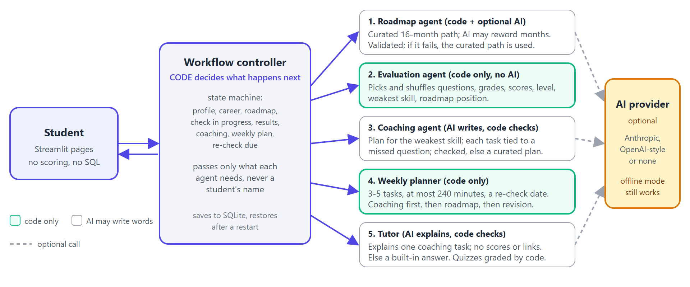
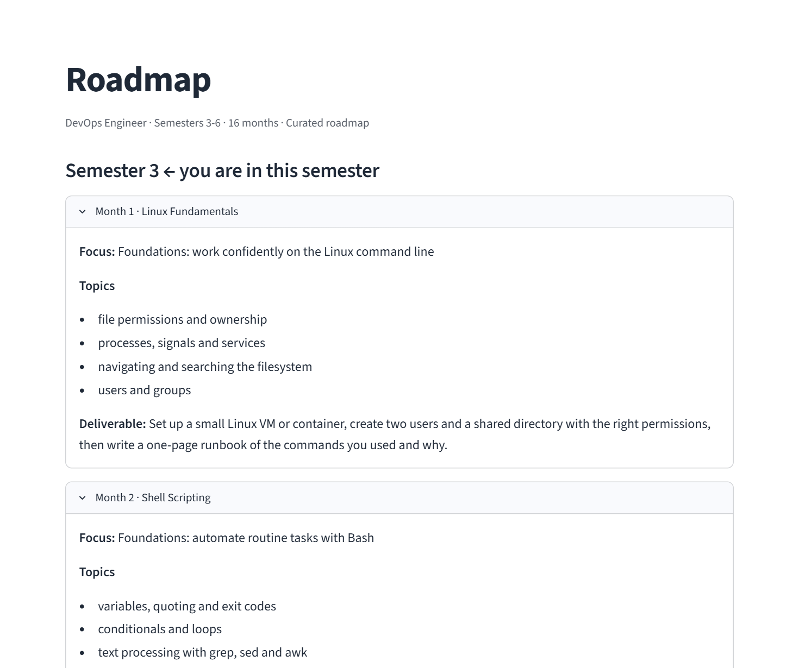
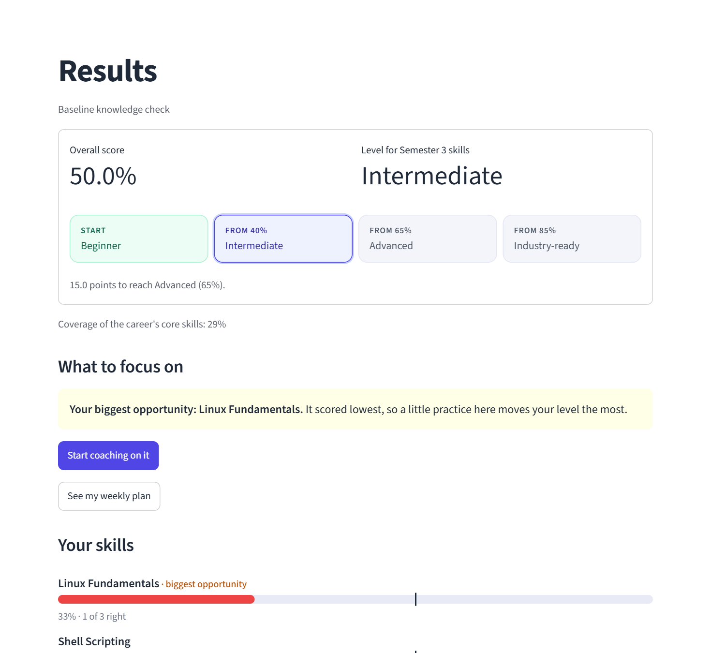
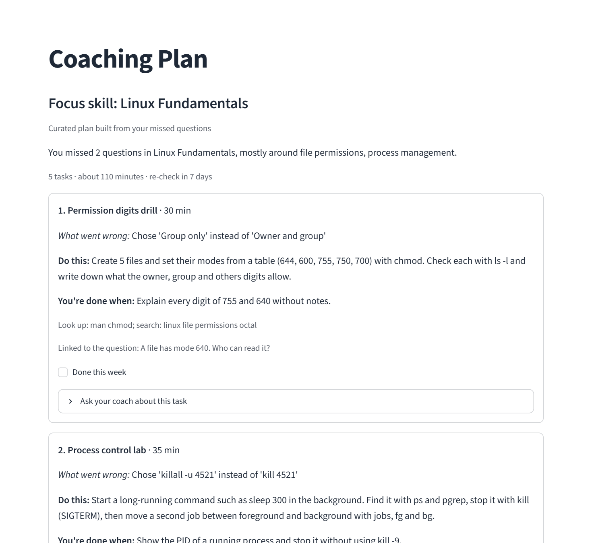

# Placement Career Coach: Product Note

**Akshat Chitkara** · Product note and working prototype, October 2026

## 1. The decision: start with Computer Science students, and do one journey properly

**Problem.** Students in Semesters 3 to 6 sit through theory-heavy lectures and arrive at placement season with no clear target role, no plan for the skills it needs, and no honest feedback on where they stand. A placement cell cannot coach hundreds of students one to one.

**User.** Undergraduate Computer Science and IT students in Semesters 3 to 6 who want a software or IT job.

**Scope decision, stated plainly.** The brief gives examples from DevOps to astronaut. I chose to support **computer science careers only** (DevOps, MEAN stack, Java backend, AI developer) and to say so on screen when a student types something else. Four reasons: technical skills have right and wrong answers that a quiz can measure fairly, which an astronaut's skills do not; these careers have widely agreed skill ladders, so a roadmap can be curated and checked instead of invented; placement tests and interviews map straight onto the skills we assess; and depth beats breadth in a short build, because four careers with questions behind every skill are more useful than forty with none. Adding ECE, VLSI or mechanical later is a content task (careers, skills, roadmaps, questions), not a rewrite.

**Promise.** Choose a career, get a Semester 3 to 6 roadmap, take a short skills check, see your level and where you stand, get a practice plan for your weakest skill, follow a weekly plan, re-check, and see what improved.

**How we would know it works.** Weekly plan completion (tasks done over tasks given); re-check rate within 10 days of a coaching plan; skill-gap closure (change in the weakest skill between checks); and level progression per semester.

## 2. The student journey and why they return every week

| Stage | The student thinks | The product does |
|---|---|---|
| 1 Choose | "Which role?" | Four careers, each with what it is, what you do and how you can grow; a wish-list box takes requests for other careers |
| 2 Plan | "What do I learn, and when?" | A 16-month roadmap, four months per semester, with topics and a deliverable for each month |
| 3 Baseline | "Where do I stand?" | A 12-question check on this semester's skills: level, per-skill scores, and a "you are here" marker on the roadmap |
| 4 Improve | "What do I fix first?" | A practice plan for the weakest skill; every task is tied to a question they missed, and a coach they can question |
| 5 Weekly | "What do I do this week?" | 3 to 5 tasks, at most four hours, ending with a re-check date |
| 6 Re-check | "Did it work?" | Seven days later, new unseen questions on the same skills, compared with last time |
| 7 Ready | "Am I placement-ready?" | A full-path check across every roadmap skill, the only route to Industry-ready |

**What brings them back.** The "you are here" marker moves as skills are mastered; the week has a concrete plan, not a reading list; there is exactly one weakest skill to fix; improvement is visible ("Linux 33% to 67%"); and the next goal is close ("15 points to Advanced"). Reminders, streaks and teacher remarks are deliberately later.

## 3. The system: a controller that decides, and modules that each do one job

| Part | Responsible for | AI or code |
|---|---|---|
| **Workflow controller** | Moves the student through the states (roadmap ready, check in progress, results, coaching, weekly plan, re-check due), decides what happens next, saves progress | Code |
| **Roadmap module** | Gives the curated 16-month path for the career. If an AI is configured it may reword the months, but a validator rejects any change to the skill order, any missing or invented skill, and any link; then the curated path is used | Code, optional AI wording |
| **Evaluation module** | Chooses questions with a fixed difficulty mix, shuffles options, grades, and works out scores, the level, the weakest skill and the roadmap position | **Code only** |
| **Coaching agent** | Writes a short plan for the weakest skill. Each task must link to a missed question or concept; plans that do not pass six checks are replaced by a curated plan built from the same mistakes | AI writes, code checks |
| **Weekly planner** | Builds the week from rules: up to two coaching tasks, then the next roadmap topic, then revision, always ending with the re-check | Code only |
| **Tutor** | Explains one coaching task on request, and runs a short practice quiz graded by code. It may not mention scores or levels | AI explains, code checks |

**Who decides what happens each week, and what is passed.** The controller does, by rules and never by AI. After a check: a skill at 60 or more counts as mastered and the roadmap marker moves on (60 to 79 also gets one light revision task); 40 to 59 stays active and gets a new plan from the new mistakes; below 40 also shows a ready-to-send message asking a mentor for help. The evaluation module hands the coaching agent only the weakest skill and the questions missed (never a name), the coaching agent hands the planner its tasks, and the planner hands the controller the week. With no AI key the whole product still works from curated content.

## 4. Choosing the assessment method, and scoring that is consistent and fair

| Skill type | Best method | Why | Status |
|---|---|---|---|
| Knowledge (Linux commands, SQL, HTTP) | Multiple-choice quiz | Objective, fast, repeatable | **Built** |
| Reasoning and design | Written answer with a rubric | Shows thinking | Later |
| Applied building (Docker, Terraform, APIs) | Hands-on assignment with a checklist | Proves ability | Later |
| Communication, interview skills | Voice interview with a rubric | Tests articulation | Later |

The method is chosen by the skill's type, in code. If a method is not built yet, the skill is shown as "assessed later" and is **never scored with a quiz instead**; the result is labelled a baseline knowledge check, not a hiring verdict.

**Scoring.** A question is right or wrong; a skill score is right over answered; the overall score is total right over total answered, with no hidden weights. Fairness comes from a fixed test: three questions per skill (easy, medium, hard), shuffled options, a skill needs two answers to count as evidence, and a re-check draws unseen questions first from a bank of at least six per skill. No AI takes part in grading, and each attempt stores the settings it was scored with, so changing a threshold later never changes an old result.

**Levels.** Below 40 is Beginner; 40 to 64.9 Intermediate; 65 to 84.9 Advanced; 85 and above Industry-ready, but only if every tested skill is at least 60 **and** the check covered every core skill of the career. A semester check covers a quarter of them, so it caps at Advanced and says why; the 28-question full-path check (two questions for each of 14 skills) is the way to Industry-ready.

**Worked example (DevOps, Semester 3).** Linux 1 of 3, Shell 1 of 3, Python 2 of 3, Git 2 of 3 gives 6 of 12, **50.0%, Intermediate**. Linux and Shell tie at 33.3, and the earlier skill on the roadmap wins, so **Linux is the weakest skill**, the student stands at Semester 3, Month 1, and the plan has three to five Linux tasks tied to the two Linux questions missed.

## 5. What I built first, next and later, and what I left out

| When | What | Why this order | Status |
|---|---|---|---|
| **First** | Career choice; roadmap; semester check; deterministic scoring and levels; weakest skill; coaching plan; weekly plan with re-check; saved progress | The brief's three parts, and the weekly loop that makes the product worth using | Built, all four careers, Semesters 3 to 6 |
| **Next** | Re-check with progress view; full-path check; coach you can question, with a practice quiz; calendar export; optional AI | Each needs the first set to exist, and each adds retention or trust | Built |
| **Later** | Written, assignment and voice assessments; career finder for undecided students; a custom career; more careers beyond CS; a teacher view; reminders and streaks | They need rubrics, reviewed content or an institution | Not built |
| **Left out** | Login and roles, proctoring, leaderboards, job marketplace, AI-written answer keys, agent frameworks | The brief did not ask for logins; proctoring and leaderboards harm learning; AI answer keys are unfair when wrong; frameworks add risk without proving the idea | Excluded |

**Prototype, as running.** Left to right: the roadmap with the student's position, the result for the worked example, and the coaching plan.

**Implemented versus planned.** Working and tested: four careers, 64 roadmap months, about 320 questions, the full journey with and without an AI, the full-path check, the coach, and over 500 automated tests, 35 of them in a real browser. Not done: the three other assessment methods, the career finder, custom careers and any non-CS career, accounts, reminders.

**Risks I would deal with before a pilot.** The questions were drafted with AI help and have not been reviewed by a person, and a level is only as trustworthy as its questions, so a subject-matter review comes first. The roadmaps are curated, not generated for each student, so personalisation today comes from the assessment, not the plan. And a quiz measures knowledge, not the ability to build, which is why the applied-skill assessments come next.
